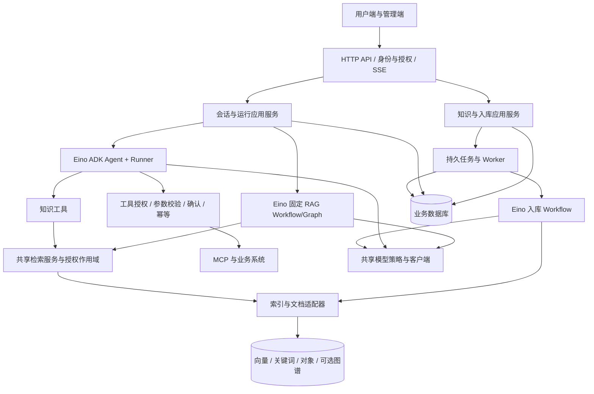

# Ragent Go：基于 Eino 的企业级 Agentic RAG 项目设计与学习主线

创建：2026-10-27；更新：2026-10-28。状态：架构初稿，第一、二课工程与本地验证已完成；完整平台尚未实现。项目暂名 `ragent-go`。

参考仓库：`/Users/admin/workspace/ragent`，本轮读取提交 `c3b61577`。未修改参考仓库，未启动其服务，未运行其测试。

文档正式目录：项目 `docs/`，与代码共同提交。原本机入口 `/Users/admin/workspace/docs/studyroom/ragent-go` 是指向本目录的快捷链接；后续只维护这一份文档。

代码目录：`/Users/admin/workspace/ragent-go/`。第一课实现与验证结果见 [课程文档](lessons/01-project-bootstrap.md)。

教学约定：每课独立一份文档，开课建立、课中更新、结课回填实际验收与复盘；索引见 [学习目录](README.md)。

课程按 [40 节主课路线](ROADMAP.md) 推进，复杂模块可拆至约 40–50 节。

本文是后续实现的主设计文档。需求、技术决策、能力验收和学习进度优先在这里更新；实现阶段再补充必要的接口规范、迁移和独立 ADR。

## 1. 能力目标与约束

### CAPABILITY

为普通用户、知识管理员和平台管理员建设完整的 Go AI 应用平台：管理员维护知识、入库流程、模型、人设、技能和工具；用户通过固定 RAG 获取有来源的答案，或通过 Agent 完成需要检索与业务操作的任务；平台提供权限控制、会话与长期记忆、人工确认、审计、追踪、质量评估和部署运维能力。以 Eino 为 AI 开发框架，以 Ragent 为源码级参考，按完整业务切片交付。

### CONSTRAINTS

- 用户已确定：Go + Eino；目标包括完整平台与企业工程能力；教学围绕真实项目设计、实现和验证展开。
- 最终范围包括用户端和管理端、固定 RAG 和 Agent 两条执行路径、文档与索引全生命周期、MCP、Skills、记忆、人工确认、模型治理与运维闭环。
- 本地配置使用项目根目录 `.env`，提供无凭据 `.env.example`；系统环境变量优先以支持部署，真实 `.env` 不入版本控制。
- 优先复用 Eino 和成熟组件；应用负责业务规则与数据安全。新增抽象须对应实际变化点，不机械翻译 Java 的类和模块。
- 本文新增的租户、知识 ACL、版本化发布等设计是 Go 版拟增强能力，不应表述为 Ragent 已完整具备的事实。
- 学习用售后助手和企业制度问答作为可替换的验收数据场景；用户尚未指定最终业务领域。示例业务工具使用独立测试数据。
- 所有阶段都包含权限、日志、错误处理和测试；生产治理阶段补齐并验证全链路，而非到最后才加入这些机制。
- 性能、可用性、保留期、供应商预算和部署规模均待测量/确认；不宣称任意并发数或可用性承诺已经成立。

### NON-GOALS

当前设计阶段不实现全部代码，不训练基础模型，不购买或调用付费服务，不推送/发布远程资源。最终项目暂不包含计费平台、自研向量数据库、自研 MCP 协议栈或通用脚本执行沙箱；后续若有业务需求，单独设计。

## 2. 本地源码证据与关键判断

以下路径均相对于参考仓库根目录，可结合本节的职责定向阅读。

| 编号 | 源码证据 | 可确认的职责/限制 | 对 Go 设计的影响 |
|---|---|---|---|
| S01 | `pom.xml`；`README.md` | 七个 Maven 模块，模块化单体；Workflow 与 Agent 两条路径 | 采用 Go 单模块、按领域分包；共享基础设施，明确调用边界 |
| S02 | `rag/.../rag/service/pipeline/StreamChatPipeline.java` | 历史加载、改写拆分、意图、歧义引导、检索、证据装配、流式生成 | 固定路径用 Eino 编排；步骤有明确输入、输出和短路条件 |
| S03 | `rag/.../rag/core/retrieval/MultiChannelRetrievalEngine.java`；`channel/`；`postprocessor/` | 多通道并发、通道超时、去重、融合、精排和富化 | 统一检索作用域和候选预算；区分空结果、超时和后端故障 |
| S04 | `rag/.../ingestion/engine/IngestionEngine.java`；`ingestion/node/` | 节点注册、单起点链式执行、环检测、节点日志与失败状态 | 不把“可编排”直接当成任意 DAG；先支持版本化顺序流水线，再按需增加分支 |
| S05 | `agent/.../config/ReActAgentProvider.java` | AgentScope ReAct、状态存储、步数/重试上限、记忆/压缩/工具等中间件 | 复用 Eino ADK 执行循环，教学聚焦中间件顺序与状态边界 |
| S06 | `agent/.../config/AgentEngineConfiguration.java`；`infra-ai/.../model/ModelRoutingExecutor.java` | Agent 单独装配 OpenAIChatModel；RAG 基础设施有候选降级执行器 | Go 两条路径统一采用模型策略，不假定源项目 Agent 自动共享全部 RAG 容错 |
| S07 | `agent/.../tool/AgentToolCatalog.java`；`McpToolProxy.java` | 工具目录快照、Schema、技能遮蔽、确认和调用失败处理 | 工具定义、授权、执行、审计分别建模；MCP 提示不能替代本地授权 |
| S08 | `agent/.../tool/KnowledgeSearchTool.java`；`rag/.../rag/service/KnowledgeSearchFacade.java` | 知识工具内部会改写、检索并再次调用模型合成；返回文本，不装配用户来源面板 | Go 拟先返回结构化证据及稳定来源 ID；比较嵌套生成的成本和效果再定模式 |
| S09 | `agent/.../memory/AgentContextTrimmer.java`；`AgentContextCompactionMiddleware.java` | 字符数水位，保护当前/未闭合工具循环，摘要失败退裁剪 | 不将字符数当精确 Token；验证压缩后 tool call/result 完整性 |
| S10 | `agent/.../memory/AgentMemoryRepository.java`；`resources/database/schema_pg.sql` | 长期记忆事实、失效时间、来源消息和用户游标；Agent 状态与消息分表 | 分开设计 UI 消息、运行检查点、上下文摘要和长期事实 |
| S11 | `agent/.../service/handler/AgentRunGate.java` | 会话互斥、用户并发名额、Redis 锁 | Go 需要跨实例互斥与租约恢复，进程内 mutex 不足以保障部署后的状态 |
| S12 | `rag/.../rag/service/ratelimit/FairDistributedRateLimiter.java` | Redis 排队、Lua 抢占、过期许可和唤醒机制 | 学习排队公平性、超时清理、名额续租与取消，不只设置 HTTP QPS |
| S13 | `resources/database/schema_pg.sql` 的知识库、用户、会话表 | 存在 created_by/user_id 等；这些字段本身不能证明完整租户隔离 | Go 的 tenant_id、成员、角色、知识 ACL 是明确新增设计，并要验证所有路径 |
| S14 | `rag/.../rag/core/retrieval/channel/GraphSearchChannel.java`；`resources/docker/graphrag/README.md` | 可选 LightRAG；注释明确单实例全图、查询后按来源分范围；图谱同步有 best-effort 边界 | 若无法在处理前隔离租户，限制部署到单租户或独立实例；补索引修复机制 |
| S15 | `frontend/src/router.tsx`；`rag/.../controller/`；`agent/.../controller/` | 登录、聊天、原文预览、知识/图谱/意图/入库/模型/技能/追踪/用户等管理入口 | 管理后台属于最终交付；接口契约可以重新设计，复用前端前先评估 |
| S16 | `resources/regression/README.md`；`agent/src/test/` | 记忆、压缩、并发、确认等已有专用回归入口 | 借鉴场景与断言，Go 版建立固定数据集和独立测试证据 |

说明：上表是源码结构与选定实现的分析，不是完整安全审计，也不证明所有异常分支已正确运行。

## 3. Ragent → Eino → 应用职责的能力地图

“机制已核对”表示官方文档/源码存在相应能力，不代表适配已编译通过。Eino-ext 的模型、存储和追踪扩展可能有独立版本，必须做依赖组合验证。

| ID | 最终能力 | 参考证据 | 拟复用机制 | 应用必须补充 | 交付阶段 |
|---|---|---|---|---|---|
| C01 | 登录、成员、角色与知识权限 | S13/S15 | Go HTTP 与认证生态，Eino 之外 | 租户、Principal、ACL、原文下载鉴权、审计 | M1 起持续 |
| C02 | 模型配置、能力校验、Prompt 版本 | S06/S15 | Eino Model/ChatTemplate、供应商扩展 | 逻辑模型档位、凭据引用、发布校验、版本快照 | M1/M6 |
| C03 | 上传、远程来源、解析与清洗 | S04 | Loader/Parser/Transformer 或成熟解析服务 | 文件限额、来源规则、SSRF 防护、失败定位 | M2/M6 |
| C04 | 分块、Embedding、入索引 | S03/S04 | Transformer、Embedding、Indexer | 分块版本、模型维度、内容哈希、批次发布 | M2 |
| C05 | 入库任务、流水线与重试 | S04 | Eino Workflow/Graph 组织步骤 | 持久任务、租约、幂等、节点日志、管理配置版本 | M2/M6 |
| C06 | 增量更新、删除、远程刷新 | S04/S14 | 存储适配器、调度基础设施 | active_version、清理任务、索引对账与补偿 | M2/M6 |
| C07 | 查询词映射、改写、拆分 | S02 | Model/Prompt/编排节点 | 多轮上下文、结构校验、原查询回退、查询数上限 | M3 |
| C08 | 意图树、多库路由、歧义引导 | S02 | 编排分支与模型节点 | 意图配置、可用库与授权库求交、追问规则 | M3/M6 |
| C09 | 向量与关键词混合召回 | S03 | Retriever、存储扩展 | 并发预算、权限过滤、超时与部分成功策略 | M3 |
| C10 | 去重、RRF、Rerank、证据门槛 | S03 | 检索生态能力优先；必要时小型后处理组件 | 稳定 ChunkKey、排名融合、模型适配、阈值评估 | M3 |
| C11 | 图谱和联网检索 | S14 | 外部服务/工具适配 Retriever | 证据归属、数据隔离、来源类型、故障降级 | M6 |
| C12 | 固定 RAG、引用、追问、反馈 | S02/S15 | Workflow/Graph、Model 流式输出 | 引用 ID、原文权限、反馈数据与推荐问题约束 | M3/M6 |
| C13 | ReAct Agent 与知识工具 | S05/S08 | ADK ChatModelAgent + Runner | 执行预算、授权检索、完成判定、业务结果核验 | M4 |
| C14 | MCP 发现、调用、Schema | S07 | Eino-ext MCP；官方 Go SDK 适配器候选 | 服务器白名单、命名空间、目录快照、参数与权限校验 | M4 |
| C15 | Skills 与按需加载 | S07 | ADK Skill middleware、Backend | 发布版本、作用域、工具开放规则、管理页面 | M5 |
| C16 | 会话、历史、裁剪、摘要 | S09/S10 | ADK Reduction/Summarization + 会话适配 | 持久消息、Token 预算、关键事实保留、回放验证 | M3/M5 |
| C17 | 跨会话长期记忆 | S10 | middleware 扩展点 | 事实提取、来源、撤销、更正、容量、用户删除与隔离 | M5 |
| C18 | 人工确认、拒绝、恢复 | S05/S07 | ADK interrupt/resume + CheckPointStore | 审批人校验、参数绑定、有效期、幂等与业务前置条件重检 | M5 |
| C19 | 停止、并发互斥、公平排队 | S11/S12 | context、ADK cancel 等机制待原型核验 | 跨节点路由、持久状态、租约、配额、丢锁保护 | M1/M4/M7 |
| C20 | 首包超时、重试、熔断、降级 | S06 | ADK retry/failover + 模型包装层 | 同一策略源、错误分类、全局尝试上限、流式轮次语义 | M1/M7 |
| C21 | Trace、用量、审计与看板 | S15/S16 | callbacks、OTel、Langfuse 扩展候选 | HTTP/任务根 Span、版本标记、脱敏、业务审计、运维指标 | M1 起持续 |
| C22 | 用户端与完整管理端 | S15 | React 控制台技术可沿用 | Go 接口适配、后台 RBAC、任务/索引/运行管理 | 各阶段配套/M6 |
| C23 | 评估、回归、部署与恢复 | S16 | Go 测试、数据集评估、部署生态 | CI、固定测试数据、故障注入、备份恢复、容量报告 | 各阶段/M7 |

M6 中延后交付的能力仍属于完整范围，不因采用可选部署 profile 就视为已经完成。

## 4. 架构与边界

### 4.1 模块化单体，API 与 Worker 可分进程运行



图中省略贯穿各层的 Trace、审计和运行指标。Worker 负责文档处理、索引修复、定时刷新及必要的记忆整理；共享代码与数据库不意味着强制同进程，也不意味着提前引入微服务。

### 4.2 拟采用的目录

```text
ragent-go/
  cmd/server/               HTTP API 装配
  cmd/worker/               持久任务执行与调度
  cmd/mcp-demo/             独立演示业务工具服务
  internal/identity/       用户、租户、成员、角色、Principal
  internal/knowledge/      知识库、文档、版本、ACL
  internal/ingestion/      入库应用服务、节点、任务与重试
  internal/retrieval/      作用域、召回、融合、排序、结构化证据
  internal/rag/            固定问答编排
  internal/agent/          ADK 装配、运行、检查点、中间件
  internal/tooling/        工具目录、MCP 适配、执行规则与审批
  internal/memory/         上下文策略、摘要与长期事实
  internal/conversation/   会话、消息、运行记录与事件
  internal/model/          模型注册、能力约束、路由和预算策略
  internal/evaluation/     数据集、回归执行与指标
  internal/platform/       配置、数据库、Redis、对象存储、遥测
  api/                     OpenAPI 与流式事件契约
  migrations/              追加式数据库迁移
  deploy/                  本地 Compose 与部署说明
  web/                     用户端与管理端
  tests/                   跨模块集成、端到端与故障场景
  docs/                    主设计及必要的技术决策
```

这是职责图，不一次性创建所有空目录。接口定义在调用方需要的位置，Eino 的组件类型可在 AI 编排层直接使用；业务实体不嵌入 Runner、数据库驱动或供应商私有类型。Agent 和固定 RAG 依赖共享检索，检索不反向依赖 Agent，也不负责整轮对话生成。

### 4.3 技术决策初稿

| 决策 | 当前建议 | 理由与验证条件 |
|---|---|---|
| HTTP 框架 | Gin v1.12.0 + 标准库 http.Server | Gin 负责路由/中间件，http.Server 负责生命周期；JSON 默认使用 encoding/json。第一课回归通过 |
| AI 框架 | 固定流程用 Eino compose；Agent 用 ADK | 两类路径各自适配业务控制方式，复用模型/检索/工具组件；不强行让所有业务代码都成为 Graph 节点 |
| Eino 基线 | 核心 `v0.9.22` 与模型扩展 `v0.1.13` 已锁定 | 2026-10-27 官方 Releases 核查时标为 Latest；已检查该 tag 的 ADK、Runner、Skill、Summarization 源码。核心与模型扩展 v0.1.13 已通过第一课本地编译/协议测试；其他扩展未锁定 |
| Go 工具链 | 选择与最终锁定扩展兼容的受支持版本，记录 patch | 不能仅看 Eino 核心的最低版本；官方 MCP 扩展 main 当前 go.mod 声明 Go 1.25.0。安装前检查本机及依赖要求 |
| 主数据库 | PostgreSQL | 参考项目现有 schema；存业务事实、审批、运行、检查点、任务、记忆与配置版本 |
| 首个向量后端 | pgvector 候选，封装适配器 | 本地参考项目已有 PgVector 实现；先降低首个部署的组件数量。性能、ACL 过滤和数据规模必须验证；Milvus 保留后续适配与对照任务 |
| 关键词后端 | 混合检索阶段引入 Elasticsearch 候选 | 单独验证中文分析、精确编号、过滤和排序。简单 LIKE 查询不算已完成生产关键词召回 |
| 对象存储 | S3 兼容存储，供应商待锁定 | 原始文件、解析产物与大工具结果；文件引用由后端授权，不公开永久可访问 URL |
| Redis | 并发租约、限流、排队、取消通知 | 不作为消息、审批或任务结果的唯一事实来源；Pub/Sub 只作唤醒/通知 |
| 异步任务 | 先用 PG 持久任务/Outbox + Worker | 先验证原子提交、认领租约、重试和幂等；需要消息代理时据吞吐/运维证据再选型，不把 RocketMQ 依赖直接照搬 |
| 图谱 | LightRAG + 图存储的隔离部署候选 | 允许复用非 Go 外部服务；先验证租户隔离和删除修复，再开放图谱能力 |
| MCP | Eino-ext 官方 Go SDK 适配器候选 | 优先复用发现/Schema/调用；传输方式、认证、断线重连与版本兼容要单独验证 |
| 观测 | OTel + 运行指标；Langfuse 适配候选 | 框架回调提供 AI 子链路；应用补齐入口/后台任务/数据库/审批审计，避免重复导出 Span |
| 前端 | React；优先评估适配原控制台 | Go API 和事件契约先定，再决定保留哪些页面；复用源码遵循项目许可证要求 |

持久任务的候选实现会用数据库行锁/认领机制；PostgreSQL 文档将 SKIP LOCKED 列为可用于队列式消费的选项。这只是认领机制，可靠性仍依赖租约、幂等和失败恢复设计。[官方 SELECT 文档](https://www.postgresql.org/docs/current/sql-select.html)

pgvector 提供 PostgreSQL 向量检索能力；具体过滤与近似索引的效果必须实测。首选它是本项目的部署与学习取舍，不是对所有规模的统一结论。[pgvector 官方仓库](https://github.com/pgvector/pgvector)

## 5. 实现契约：数据、状态与接口

### IMPLEMENTATION CONTRACT

角色：普通成员、知识管理员、平台管理员；Worker 和外部工具使用受限服务身份。平台管理员拥有的管理权限不自动等同于所有业务数据的阅读权限，具体策略随身份模块确定。

### 5.1 必须分别建模的对象

| 对象 | 关键内容 | 与其他对象的区别 |
|---|---|---|
| Principal / Tenant / Membership | 用户、租户、成员与权限版本 | 由认证与数据库生成；不能信任模型参数中的 tenant_id/user_id |
| KnowledgeBase / Document / DocumentVersion / Chunk | 归属、来源、内容哈希、解析/分块配置、模型与索引代次 | 文档身份稳定；内容版本与索引版本可变 |
| IngestionTask / NodeAttempt / Outbox | 任务状态、执行次数、租约、节点产物与错误分类 | 不能仅用一条内存队列代表持久任务 |
| Conversation / Message / Run | 用户交互、可展示消息、一次执行的状态与配置快照 | 会话不等于单次运行；一次运行可能暂停后多次恢复 |
| Checkpoint | Eino 序列化状态、版本、所属 run、校验摘要 | 不作为 UI 消息数据库，也不承诺任意崩溃位置都可安全恢复 |
| ToolInvocation / Approval | 业务操作 ID、工具及 Schema 版本、参数哈希、审批人/有效期/结果 | 审批批准是授权记录，实际业务提交还要再次校验 |
| MemoryFact / CompactionRecord | 事实来源、范围、失效与修改记录、压缩审计 | 长期记忆与摘要生命周期不同；摘要不是永久正确事实 |
| ModelProfile / PromptVersion / SkillVersion / ToolCatalogSnapshot | 发布版本与用途 | 新配置用于新运行；在途和待恢复运行绑定原快照 |
| Feedback / EvalCase / EvalRun / AuditEvent | 质量证据、回归结果和业务审计 | Trace 可采样；关键业务审计不可依赖采样 Trace 代替 |

所有租户数据的唯一键、索引和跨表关联都需要考虑 tenant_id。对象存储、搜索索引、缓存、检查点和记忆也必须使用同一作用域；只给数据库表加一列不足以实现隔离。

### 5.2 三类状态流转

```text
入库任务：queued → running → succeeded
                     ├→ retry_wait → queued
                     ├→ failed
                     └→ cancelled
租约失效：重新认领前检查 attempt/fencing token 和已完成产物

运行：queued → running → completed / failed / cancelled
                  └→ waiting_approval → queued → running
                            └→ expired / cancelled
拒绝审批：回传结构化拒绝结果，进入可解释的后续决策或正常结束；不执行原操作

审批：pending → approved / rejected / expired
工具：planned → waiting_approval → executing → succeeded / failed / unknown
只读工具可从 planned 进入 executing；unknown 必须查询业务状态或人工处理
```

审批处于 pending 不占用长期运行 goroutine，也不长期占用模型并发名额。租约是临时执行权；等待审批期间仍保留会话的持久业务状态。本版策略：该会话有待审批运行时拒绝新执行，可取消/处理原运行后继续；不能仅靠等待期间的 Redis 锁表达它。

### 5.3 文档与索引发布规则

1. 数据库记录新文档版本和任务，同事务产生待执行记录；文件上传与数据库事务不原子，需暂存对象、校验引用并清理孤儿文件。
2. Worker 为版本生成解析产物、Chunk 和目标索引。产物以版本和内容哈希标识，重复执行可识别已完成步骤。
3. 校验必需索引就绪后，数据库切换 active_version；发布需乐观并发控制，过期 Worker 不得覆盖新版本。
4. 检索层仅接收授权且已发布版本，回传证据再校验当前有效性后才进入 Rerank/生成；物理索引切换与缓存失效的窗口要有测试。
5. 文档删除/禁用先令其不可被使用，再异步清理向量、关键词、图谱及对象。失败可重试和对账，不将“发出删除请求”记为全部清理成功。
6. 必需索引与可选索引由发布配置显式声明；缺少可选图谱可标记降级，缺少必需索引不得显示成功。

### 5.4 工具确认与执行规则

- 工具执行入口统一处理：身份、工具目录版本、Schema、资源权限、预算、审批和业务幂等；本地工具与 MCP 都经过该入口。
- 不把 MCP readOnlyHint 当可信授权来源；应用维护可信配置，未知风险工具默认需要确认或不开放。
- 审批绑定 tenant/user/run/checkpoint/tool/schema/规范化参数哈希与有效期；审批后的参数变化必须重新确认。
- 恢复时重新检查身份、资源权限、配置可恢复性和业务前置条件，例如订单状态是否已变化。
- 对写操作使用稳定业务 operation_id；调用成功但回包丢失时先查询结果。下游不支持幂等/查询时保留 unknown，禁止自动盲重试。
- Checkpoint 解决执行状态恢复，不能提供跨系统 exactly-once；不能把“支持 Resume”解释为“任意失败都不会重复写”。
- 进程崩溃后的恢复分三种：安全检查点后可续跑、只读步骤可重算、写入结果不明需对账。明确记录所处情况。

### 5.5 拟定 API 与事件边界

以下是本项目草案，不是照搬 Ragent 已有接口，也不是当前已实现接口。

| 接口 | 输入/作用 | 关键契约 |
|---|---|---|
| `POST /api/v1/knowledge-bases` | 创建知识库 | Principal 决定租户；知识管理员权限 |
| `POST /api/v1/knowledge-bases/{id}/documents` | 上传并创建文档/任务 | 有限文件大小、内容校验、返回 document_id/task_id |
| `GET /api/v1/ingestion-tasks/{id}` | 任务和节点执行状态 | 有权限才能读错误与产物；错误对外脱敏 |
| `POST /api/v1/conversations/{id}/runs` | 输入问题、mode=rag/agent、客户端请求键 | 返回 run_id；同请求键和同载荷复用结果，异载荷报冲突；模型与租户字段不由用户越权指定 |
| `GET /api/v1/runs/{id}/events` | 鉴权 SSE | 订阅不触发新执行；event_id/seq 支持补发，超过保留窗口返回明确过期语义 |
| `POST /api/v1/runs/{id}/approvals/{approval_id}` | approved/rejected + 决策请求键 | 校验审批身份/参数摘要/状态；重复决策不重复执行 |
| `POST /api/v1/runs/{id}/cancel` | 主动取消 | 幂等；跨实例找到执行者；晚到回调不能覆盖终态 |
| `GET /api/v1/runs/{id}` | 查询持久状态 | 流断开后也能查询最终结果 |

事件拟包含：run_started、retrieval_completed、tool_started、tool_completed、approval_required、message_delta、attempt_reset、run_completed、run_failed、run_cancelled。每条携带 run_id、seq、type、time、payload；生成事件另有 message_id、attempt_id，工具事件另有 invocation_id。

为避免“断线重连造成重复任务”，运行与 SSE 订阅解耦：订阅断开只关闭该订阅，运行遵循自身超时/取消策略。所有运行有截止时间，显式取消传播到模型与下游；这与直接将整个运行绑定 HTTP 请求 context 的行为不同。

语义事件持久化，token delta 按批次持久化或合并为可回放片段，限定缓冲和保留期；慢订阅者断开后可补发，不能无限堆积内存。不能用 Redis Pub/Sub 承诺历史补发。

流式失败重试时，已发出的内容不能无声拼接备用模型输出；用 attempt_reset 与 attempt_id 告知前端替换对应内容。最终消息只落当前有效轮次，保留失败轮次的诊断记录。

## 6. 质量、观测与安全验收

以下为拟定开发验收，性能类阈值在 M1/M2 建基线后确定；它们尚未达成。

| 维度 | 验收用例/指标 | 证据 |
|---|---|---|
| 隔离 | 两租户同名文档、同名工具资源和相似问题，数据库/缓存/检索/记忆/预览/审批/SSE 均无越权 | 确定性集成测试，受限测试主体 |
| 入库一致性 | 重复提交、Worker 中断、旧 Worker 晚到、新版本发布、删除清理失败 | 任务快照、索引对账和恢复记录 |
| RAG 质量 | 建立至少 30 条起步标注集，含精确编号、同义问法、多轮指代、无答案和越权问题 | Recall@K、MRR、引用有效率、人工核查；保留独立测试集 |
| Agent 正确性 | 查政策+查订单+确认操作、拒绝、权限撤销、工具失败、步数耗尽 | 工具轨迹与业务结果核对；不能只以最终回答自称成功为依据 |
| 幂等与恢复 | 重复审批、确认后进程重启、工具成功但回包丢失 | 数据库唯一约束、业务 operation_id、结果查询记录 |
| 上下文 | 长工具结果、压缩后继续调用、偏好更正/删除、跨会话与跨用户 | 断言调用/结果完整，记忆来源与失效记录，固定回放集 |
| 模型容错 | 首包超时、429、5xx、空响应、中途流断、用户取消 | 总重试预算、attempt_reset 行为、熔断状态、取消不误触发降级 |
| 运维 | 检索/工具/模型耗时、首个有用事件耗时、队列等待、Token、失败率、索引滞后 | Trace + 指标 + 版本信息；超时与失败不和空检索混为一谈 |
| 隐私与注入 | 检索文档/工具结果含伪造指令，日志含敏感字段，恶意远程 URL | 数据按不可信输入处理；不扩权限；脱敏、出网规则与审计 |
| 性能与部署 | 在记录的硬件、数据量、模型条件下压测；数据库/对象备份恢复演练 | p50/p95、并发、错误率、资源与成本报告；区分本地依赖和供应商耗时 |

模型策略只定义一份候选、预算与错误分类，RAG 和 Agent 按用途引用；ADK 内置重试与模型包装重试不能各自无限叠加。熔断与健康状态需决定作用域、更新方式与恢复探测，并用故障实验验证。

## 7. 分阶段交付与教学计划

| 阶段 | 可运行交付 | 主要源码锚点 | 学习检验 |
|---|---|---|---|
| M0 设计与兼容原型 | 本文 + 依赖矩阵验证报告；原型验证 ADK 事件、中断恢复、MCP 和模型流式契约 | S01/S05/S06/S07 | 能说明框架机制与业务保障的边界 |
| M1 工程与运行底座 | 工程初始化、配置/迁移、身份与租户基础、模型配置、Run/事件、流式接口、Trace、CI | S06/S11/S13/S15 | 能画出一次请求的身份、运行与数据边界 |
| M2 知识入库 | 管理员建库、上传 Markdown/TXT、解析分块、Embedding、索引发布、任务管理页、重试/删除 | S04/S13 | 能处理重复任务、版本竞争和多存储不一致 |
| M3 RAG 闭环 | 改写/拆分、意图/路由、混合检索、融合/精排、引用、会话/反馈，用户界面及初始评估 | S02/S03/S08 | 能定位一次回答失败的环节，并用数据比较策略 |
| M4 Agent/MCP | ADK 主 Agent、共享知识工具、订单查询与受控演示工具、远程发现、工具时间线、并发与取消 | S05/S07/S08/S11 | 能解释 Agent 如何选下一步，权限如何独立于模型生效 |
| M5 确认与记忆 | 持久 Checkpoint、人工确认/拒绝/恢复、幂等、Skills、裁剪/摘要、长期记忆管理 | S07/S09/S10/S16 | 能解释消息/运行/检查点/摘要/长期事实的不同生命周期 |
| M6 完整功能 | PDF/Office/网页来源与刷新、可配置入库、图谱/联网检索、人设/技能/意图/模型完整管理、推荐追问与看板 | S04/S14/S15 | 能解释配置版本、数据归属及可选能力降级 |
| M7 系统验收 | 模型容错、公平排队、跨节点控制完整验证；部署、压测、安全/恢复演练和最终能力逐项核对 | S06/S11/S12/S16 | 能基于证据说明容量、质量、成本、风险和演进取舍 |

每个阶段均按“业务场景 → 原源码 → Eino 机制 → Go 设计 → 小批实现 → 测试/故障实验 → 学员复盘”推进。导师给出边界和必要示例，用户参与关键设计与实现；不一次生成整套成品跳过学习过程。早期阶段可运行的范围较小，完整范围不缩减。

### 第一节课：先读懂一轮请求的责任边界

场景 A：“公司出差住宿报销标准是多少？”

1. 身份层得到当前租户、用户与可访问知识库。
2. RAG 路径加载会话、改写查询、解析意图；路由库与授权库求交集，路由不能授予权限。
3. 检索层在同一授权范围内进行多路召回、融合和精排，返回含 chunk_id/doc_version/source 的证据。
4. 生成层依据证据回答，流式事件包含稳定引用；原文预览仍要独立鉴权。

场景 B：“看看我的 A100 订单能否退货，符合条件就申请。”

1. 同样先形成可信身份。Agent 通过工具选择查询订单和政策；订单归属在工具服务端验证。
2. Agent 汇总结果形成明确操作参数，应用检查业务条件并触发审批中断。
3. Checkpoint 与审批就绪后向用户展示；保存 run_id 和审批绑定，释放执行名额。
4. 用户批准，应用重新授权和校验参数/业务状态；带稳定 operation_id 执行。
5. 工具结果与真实业务结果核对后完成；拒绝、过期、超时和结果未知各有独立路径。

本课只需能回答：决策由谁做、权限由谁检查、证据在哪里产生、状态存在哪里、写操作何时发生。下一节再通过依赖原型验证这些边界可落到 Eino 上。

### 学习记录

- [x] 确认 Go + Eino 和完整企业平台目标。
- [x] 阅读本地核心源码并整理能力地图、架构与验收草案。
- [x] 核对 Eino 官方文档与部分固定 tag 源码。
- [x] 第一课：Go 1.27.3 + Eino v0.9.22 + 模型扩展 v0.1.13 已编译，服务/模型本地测试与进程冒烟通过。
- [ ] 完整兼容原型：继续验证 ADK/MCP/Checkpoint/Skills/追踪扩展组合；真实供应商待联调。
- [x] 第二课：只读订单工具 + ADK + CLI 本地验证通过，最终实现提交 5893209；真实工具调用待联调。
- [ ] 首次学员复盘：说明固定 RAG 与 Agent 的责任边界。
- [ ] 进入 M1，逐个交付工程基础能力。

## 8. 未决事项与下一步

### OPEN QUESTIONS

| 事项 | 当前假设 | 何时需要决定 |
|---|---|---|
| 最终业务场景 | 企业知识问答 + 模拟售后任务 | 数据集和演示工具实施前；不阻碍工程底座 |
| 模型服务与预算 | 配置式接入，使用用户已有授权服务；离线测试用替身 | 真实集成前；不在设计文档保存凭据 |
| 硬件和现有 Go/Docker | 已安装本机公共 Go 1.27.3（~/.local/bin/go），Docker 仅确认客户端；默认分 profile 启动依赖 | 初始化前先只读检查，再决定工具链和本地组件 |
| Eino-ext 版本组合 | 核心 v0.9.22 与模型扩展 v0.1.13 已锁定；MCP/追踪等扩展仍待验证 | M0 原型完成后固定 go.mod/go.sum；不能依赖 main 示例永久不变 |
| HTTP/SQL/认证具体库 | HTTP 已选 Gin v1.12.0 并迁移，SQL 与认证库待选 | M1 模块实施前记录小型 ADR，不为选择框架提前重写通用机制 |
| 目标规模、SLO、保留期 | 未知，先采基线 | 性能承诺、容量评估与上线验收前 |
| 新代码目录 | 设计文档位于指定目录；代码已建立在 `/Users/admin/workspace/ragent-go/` | 初始化时在当前可写工作区建立独立实现目录；原 Java 仓库保留为只读参考 |

### HANDOFF

已完成第一课的工程初始化与核心/模型适配验证；第二课 ADK 只读工具原型已通过本地验证；继续真实工具联调、M0 的 MCP/状态恢复原型和 M1 运行契约设计。工具链与核心模型依赖已锁定，其他扩展按使用阶段继续核验。没有真实模型凭据时仍可用可控模型替身验证编排，不创建付费任务。

本设计不需要以所有未决项一次确认作为开始条件；在相应实现步骤到来前给出明确建议，并保留变更原因。

## 9. 官方资料与版本证据

以下均为 2026-10-27 本轮访问。文档可能随主分支演进；编写具体 API 代码以最终锁定 tag 为准。特别是本轮不同官方页面的 CheckPointStore 示例签名存在差异，不直接混抄接口。

- [Eino Releases](https://github.com/cloudwego/eino/releases)：核对非预发布候选 v0.9.22，另有 alpha 发布；本文未选用 alpha。
- [Eino Components](https://www.cloudwego.io/docs/eino/core_modules/components/)：模型、文档、Embedding、Indexer、Retriever、工具等组件边界。
- [Workflow 编排](https://www.cloudwego.io/docs/eino/core_modules/chain_and_graph_orchestration/workflow_orchestration_framework/)：固定数据流的编排候选。
- [ChatModelAgent](https://www.cloudwego.io/docs/eino/core_modules/eino_adk/agent_implementation/chat_model/)：ReAct、middleware、运行配置机制。
- [v0.9.22 ChatModelAgent 源码](https://github.com/cloudwego/eino/blob/v0.9.22/adk/chatmodel.go)：核对 tag 中 ADK 与模型容错配置的存在。
- [Runner 与扩展](https://www.cloudwego.io/docs/eino/core_modules/eino_adk/agent_extension/)；[v0.9.22 Runner 源码](https://github.com/cloudwego/eino/blob/v0.9.22/adk/runner.go)：事件消费、中断、检查点与恢复入口。
- [Skill middleware](https://www.cloudwego.io/docs/eino/core_modules/eino_adk/eino_adk_chatmodelagentmiddleware/middleware_skill/)；[v0.9.22 源码](https://github.com/cloudwego/eino/blob/v0.9.22/adk/middlewares/skill/skill.go)：按需加载与 Backend 扩展。
- [Summarization](https://www.cloudwego.io/docs/eino/core_modules/eino_adk/eino_adk_chatmodelagentmiddleware/middleware_summarization/)；[v0.9.22 源码](https://github.com/cloudwego/eino/blob/v0.9.22/adk/middlewares/summarization/summarization.go)：摘要 middleware 与扩展点。
- [Reduction](https://www.cloudwego.io/docs/eino/core_modules/eino_adk/eino_adk_chatmodelagentmiddleware/middleware_toolreduction/)：工具结果裁剪机制候选，具体行为需原型验证。
- [ChatModel Failover](https://www.cloudwego.io/docs/eino/core_modules/eino_adk/agent_implementation/chat_model/chatmodel_failover_guide/)：模型切换与流式轮次处理；前端不能假设失败输出自动撤回。
- [Eino-ext 官方 MCP 适配器 README](https://github.com/cloudwego/eino-ext/blob/main/components/tool/mcp/officialmcp/README_zh.md)；[go.mod](https://github.com/cloudwego/eino-ext/blob/main/components/tool/mcp/officialmcp/go.mod)：发现/调用机制候选、独立模块与工具链要求。
- [Eino-ext Langfuse v2 README](https://github.com/cloudwego/eino-ext/blob/main/callbacks/langfuse/v2/README.md)：OTel/OTLP 追踪候选；其组件版本与目标 Langfuse 版本需成对验证。

以上资料支持“框架/扩展存在这些机制”；本文的租户、审批绑定、版本化索引、运行事件、任务恢复和部署选择是项目设计建议，并非 Eino 自动提供的业务保证。
